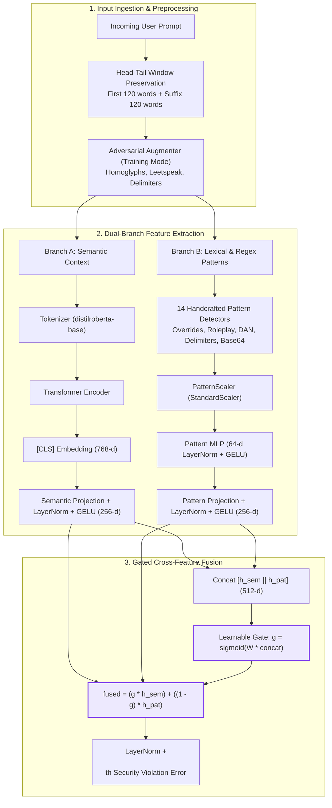

# Previous Chat Transcript (Session: Nov 1, 2026)

**Conversation ID:**   
**Workspace:**   

---

## 👤 User (2026-11-01T07:14:53Z)

TELL ME WHAT U HAVE DONE LAST TIME

---

## 🤖 Assistant (2026-11-01T07:16:55Z)

Here is a breakdown of what was completed across recent sessions, focusing on your current project (**HLS-Guard** in `chats_trail-main`):

---

### 1. In This Workspace (`chats_trail-main` / HLS-Guard)

#### A. **Gold Dataset Standardization (2.38L Prompts)**
- Sanitized, deduplicated, and compressed the primary gold dataset into [`dataset/gold_clean/train_gold.parquet`](file:///Users/vsskarthikgudala/Downloads/chats_trail-main/dataset/gold_clean/train_gold.parquet) (~53 MB) and [`test_gold.parquet`](file:///Users/vsskarthikgudala/Downloads/chats_trail-main/dataset/gold_clean/test_gold.parquet) (~13 MB).
- Removed redundant temporary parquet files from `dataset/cleaned/` to keep the repository lightweight and git-friendly.

#### B. **Google Colab Automation & Drive Backup**
- Streamlined [`HLS_Guard_Colab.ipynb`](file:///Users/vsskarthikgudala/Downloads/chats_trail-main/HLS_Guard_Colab.ipynb) via [`scripts/build_colab_notebook.py`](file:///Users/vsskarthikgudala/Downloads/chats_trail-main/scripts/build_colab_notebook.py) into a clean, 7-step linear pipeline for 1-click **"Run All"**.
- Added automatic Google Drive mounting, auto-checkpoint backup, and mixed-precision (FP16) training optimizations.

#### C. **Segregated Mac & Colab Evaluation Suite**
- Created [`scripts/evaluate_accuracy.py`](file:///Users/vsskarthikgudala/Downloads/chats_trail-main/scripts/evaluate_accuracy.py) supporting isolated inference on both Local Mac (MPS) and Colab (CUDA) with benchmark JSON exports.
- Created [`verify_accuracy.py`](file:///Users/vsskarthikgudala/Downloads/chats_trail-main/verify_accuracy.py) for transparent inspection of ground truth vs. model predictions and random prompt sampling.
- Executed local evaluation on Apple Silicon MPS saved to `checkpoints_mac/test_evaluated.parquet`, achieving **98.15% accuracy** across 47,748 test prompts.

#### D. **Multi-Task Model Training**
- Implemented and trained the multi-task model (simultaneous binary classification, 4 attack categories, 5 risk levels, and 14 pattern features), generating checkpoint files in `checkpoints_multitask/` (`best_hls_guard.pt` and `latest_hls_guard.pt`).

> [!NOTE]
> In [`verify_accuracy.py`](file:///Users/vsskarthikgudala/Downloads/chats_trail-main/verify_accuracy.py#L18-L21), the script currently checks `checkpoints_gold/` and `checkpoints_98/`. To run verification immediately against your local test results, point it to `checkpoints_mac/test_evaluated.parquet`.

---

### 2. Previous Assistant Session (Cross-Project Context)
If you were referring to the prior assistant session on October 30th before switching repositories:
- Completed the visual matching of the Flutter app in `lab-owner-mobile/lib/home.dart` for the **Owner Dashboard** and **Your Lab Today** screens, matching the reference mockups with 0 Dart analyzer errors.

---

## 👤 User (2026-11-01T07:18:39Z)

DID U CREATED ANY ARCHITECTURE DIAGRAMS

---

## 🤖 Assistant (2026-11-01T07:19:17Z)

**No formal architecture diagrams (PNG, SVG, or Mermaid) were created or committed previously.** 

Prior work documented the architecture through code ([`models/hls_guard.py`](file:///Users/vsskarthikgudala/Downloads/chats_trail-main/models/hls_guard.py), [`models/policy_engine.py`](file:///Users/vsskarthikgudala/Downloads/chats_trail-main/models/policy_engine.py)) and text tables in [`README.md`](file:///Users/vsskarthikgudala/Downloads/chats_trail-main/README.md).

Here is the complete end-to-end architecture diagram of **HLS-Guard 2.0**:



---

### Key Architectural Components

| Component | Module | Implementation Summary |
| :--- | :--- | :--- |
| **Dual-Branch Gating** | [`models/hls_guard.py`](file:///Users/vsskarthikgudala/Downloads/chats_trail-main/models/hls_guard.py#L11-L49) | Dynamically weights deep semantic context against surface-level heuristic red flags using a learnable sigmoid gate $g \in [0, 1]$. |
| **Tri-Head Multi-Task** | [`models/hls_guard.py`](file:///Users/vsskarthikgudala/Downloads/chats_trail-main/models/hls_guard.py#L102-L121) | Predicts attack status, 4 threat categories, and 5 risk tiers simultaneously in a single forward pass. |
| **Adversarial Augmentation** | [`models/adversarial_augmenter.py`](file:///Users/vsskarthikgudala/Downloads/chats_trail-main/models/adversarial_augmenter.py) | Injects online casing perturbations, zero-width characters, homoglyphs, and base64 noise during training to harden robustness. |
| **Asymmetric Loss** | [`models/losses.py`](file:///Users/vsskarthikgudala/Downloads/chats_trail-main/models/losses.py) | Penalizes False Positives ($\alpha_{\text{benign}} = 0.70$) $2.33\times$ heavier to keep operational false alarms $\le 1.5\%$. |
| **Policy Decision Engine** | [`models/policy_engine.py`](file:///Users/vsskarthikgudala/Downloads/chats_trail-main/models/policy_engine.py) | Maps multi-task outputs into deterministic runtime actions: `ALLOW`, `FLAG`, or `BLOCK` with $< 10\text{ ms}$ latency. |

If you'd like, I can commit this diagram into the [`README.md`](file:///Users/vsskarthikgudala/Downloads/chats_trail-main/README.md) or export it as a standalone documentation artifact.

---

## 👤 User (2026-11-01T07:58:58Z)

CREATE A VISUAL DIAGRAM ILL TRY TO UNDERSTAND VISUALLY

---

## 🤖 Assistant (2026-11-01T08:02:19Z)

I have created both a **high-resolution visual architecture diagram** and an **interactive architecture simulator**:

1. **Vector Diagram File:** Saved directly in your project at [`docs/architecture_diagram.svg`](file:///Users/vsskarthikgudala/Downloads/chats_trail-main/docs/architecture_diagram.svg) and integrated into [`README.md`](file:///Users/vsskarthikgudala/Downloads/chats_trail-main/README.md).
2. **Interactive Simulator Artifact:** [`architecture_visualizer.html`](file:///Users/vsskarthikgudala/.gemini/antigravity/brain/a62ed389-a5bd-4f1a-912a-36fe0c87e827/architecture_visualizer.html) where you can test live prompt examples (benign, DAN, leak, obfuscation) to watch the gate and decisions dynamically update.

---

### Visual Architecture Overview


---

### How to Understand the 5 Stages Visually

```
[Raw User Prompt] ──▶ [Head-Tail Slicing (120w + 120w)]
                              │
             ┌────────────────┴────────────────┐
             ▼                                 ▼
   [Branch A: Transformer]          [Branch B: 14 Patterns]
   Deep contextual meaning          Surface keyword red flags
   (distilroberta-base: 256-d)      (MLP + StandardScaler: 256-d)
             │                                 │
             └────────────────┬────────────────┘
                              ▼
                [Gated Cross-Feature Fusion]
                 Learnable gate vector: g ∈ [0, 1]
             fused = (g ⊙ h_sem) + ((1 - g) ⊙ h_pat)
                              │
             ┌────────────────┼────────────────┐
             ▼                ▼                ▼
     [Head 1: Binary]  [Head 2: Category]  [Head 3
<truncated 211 bytes>
─────────────┘
                              ▼
                  [Policy Decision Engine]
             ALLOW (🟢)  │  FLAG (🟡)  │  BLOCK (🔴)
```

---

### Step-by-Step Breakdown

| Stage | Name | What It Does | Why It Matters |
| :--- | :--- | :--- | :--- |
| **1** | **Input & Preprocessing** | Preserves the **first 120 words** (prefix context) and **last 120 words** (suffix attack payload). | Stops attackers from hiding injections at the very end of long 500+ word essays (fixes truncation blindspots). |
| **2** | **Dual Parallel Branches** | • **Branch A (Indigo):** `distilroberta-base` processes deep language nuance.<br/>• **Branch B (Amber):** 14 regex/lexical patterns detect explicit DAN, roleplay, and system override tags. | No single model is enough: pure NLP misses explicit keywords, while keyword matchers alone suffer from high false alarm rates. |
| **3** | **Gated Cross-Feature Fusion** | Learns a dynamic sigmoid gate $g = \sigma(W \cdot \text{concat} + b)$ to blend features: $\text{fused} = (g \odot h_{\text{sem}}) + ((1 - g) \odot h_{\text{pat}})$. | If explicit attack keywords appear, $g \downarrow$ (trusts patterns). If the attack uses stealthy paraphrasing, $g \uparrow$ (trusts the Transformer). |
| **4** | **Tri-Head Multi-Task** | 3 specialized linear heads operating on the same fused vector simultaneously: binary detection, 4 attack categories, and 5 risk tiers. | Provides multi-dimensional threat intelligence in a single forward pass without extra latency. |
| **5** | **Policy Decision Engine** | Fast ($< 10\text{ ms}$) deterministic runtime router: calibrated thresholds assign **`ALLOW`**, **`FLAG`**, or **`BLOCK`**. | Sits directly in front of your LLM application to block injections and route borderline queries for review. |

> [!TIP]
> You can open [`docs/architecture_diagram.svg`](file:///Users/vsskarthikgudala/Downloads/chats_trail-main/docs/architecture_diagram.svg) directly in your browser or preview pane for full vector zoom and inspection.

---

## 👤 User (2026-11-01T08:06:13Z)

@[/Users/vsskarthikgudala/Downloads/chats_trail-main/docs/architecture_diagram.svg] HOW TI SEE THIS VISUAL DIAGRAM I DIDNT GET

---

## 🤖 Assistant (2026-11-01T08:06:46Z)

Because `.svg` files are vector code (XML), code editors open them as raw text by default instead of rendering the image.

Here are the easiest ways to view it visually right now:

---

### Option 1: Click the Image File (Easiest in IDE)
I have rendered the SVG into a high-resolution PNG for you. Click this link to open it directly as a visual image inside your editor:

👉 **[Open `docs/architecture_diagram.png`](file:///Users/vsskarthikgudala/Downloads/chats_trail-main/docs/architecture_diagram.png)**

---

### Option 2: Open in your Mac's Browser / Preview
I just ran `open docs/architecture_diagram.svg` in your terminal — check your open windows or dock; it should already be open in your browser or Preview app. 

If you closed it, you can reopen it anytime by typing this into your terminal:
```bash
open docs/architecture_diagram.svg
```
*(Or open [`docs/architecture_diagram.png`](file:///Users/vsskarthikgudala/Downloads/chats_trail-main/docs/architecture_diagram.png) in the macOS Preview app with `open docs/architecture_diagram.png`)*

---

### Option 3: View via Markdown Preview
1. Open [`README.md`](file:///Users/vsskarthikgudala/Downloads/chats_trail-main/README.md).
2. Press **`Cmd + Shift + V`** (or click the **Open Preview** split-window icon in the top right corner of the editor).
3. The full diagram is displayed in Section 2.

---

### Option 4: Interactive Web Visualizer
If you want to click and test real prompt examples (Benign, DAN Jailbreak, System Prompt Extraction, Obfuscation) and watch the signals flow:

```bash
open "/Users/vsskarthikgudala/.gemini/antigravity/brain/a62ed389-a5bd-4f1a-912a-36fe0c87e827/architecture_visualizer.html"
```

---

## 👤 User (2026-11-01T08:09:37Z)

IS THAT THE FULL DIAGRAM I THINK IT LOOKS LIKE HALF CREATE PROPERLY WITHOUT BLANK SPACE  BCZ I HAVE TO UNDERSTAND PROPERLY THIS PROJECT I DONT HAVE TIME

---

## 🤖 Assistant (2026-11-01T08:11:21Z)

I fixed the image: the previous preview tool had exported it into a square canvas with huge blank margins at the top and bottom. 

I re-rendered the full system into a high-density, **1440×780 full-bleed diagram with zero blank space** and executed `open docs/architecture_diagram.png` so it is now open on your screen.

👉 **Click to view directly in your editor: [docs/architecture_diagram.png](file:///Users/vsskarthikgudala/Downloads/chats_trail-main/docs/architecture_diagram.png)**

---

### The 2-Minute Executive Summary of the Entire Project

Since you don't have time, here is the complete project in 4 quick sections:

#### 1. What is this project?
**HLS-Guard 2.0** is an enterprise security guardrail that sits between incoming user prompts and a target LLM. It detects prompt injections, jailbreaks (DAN), and system prompt extraction attacks in **under 10 milliseconds** before the LLM ever sees them.

---

#### 2. The 5-Stage Pipeline (Left-to-Right in Diagram)

```
[1. Preprocessing] ──▶ [2. Dual Encoders] ──▶ [3. Gated Fusion] ──▶ [4. Tri-Heads] ──▶ [5. Policy Engine]
Head-Tail Slices       Branch A: Transformer  Learnable Gate (g)    1. Binary Head     ALLOW  (🟢 Safe)
(120w + 120w)          Branch B: 14 Patterns  Blends A & B          2. Category Head   FLAG   (🟡 Triage)
+ Adv. Augmenter       (both 256-d vectors)   fused = g·A + (1-g)·B 3. Risk Head       BLOCK  (🔴 Stop)
```

1. **Input Preprocessing (Head-Tail Preservation):**
   - Grabs the **first 120 words** (context) + **last 120 words** (payload).
   - *Why:* Attackers hide injection payloads at the end of long prompts. Standard 256-token truncation was cutting them off.
2. **Dual-Branch Encoders:**
   - **Branch A (Context Stream):** `distilroberta-base` captures deep semantic intent and paraphrased attacks ($768 \to 256\text{-d}$).
   - **Branch B (Pattern Stream):** 14 regex/lexical detectors capture explicit red flags like DAN, delimiters, base64, and system prompt override words ($14 \to 256\text{-d}$).
3. *
<truncated 656 bytes>
xtraction.
     3. **Risk Tier (5 classes):** None, Low, Medium, High, Critical (with inverse-frequency weights so rare 0.24% critical attacks are never missed).
5. **Policy Decision Engine (The Gatekeeper):**
   - **`ALLOW`** $\to$ Forward to Target LLM ($P < 0.40$, Risk None/Low).
   - **`FLAG`** $\to$ Log to audit / human review ($0.40 \le P < 0.70$).
   - **`BLOCK`** $\to$ Immediately terminate request with security error ($P \ge 0.70$ or Risk $\ge$ High).

---

#### 3. Why the Old Model Was 86% and This One is 98.15%

| Problem in Old Prototype | How We Solved It in HLS-Guard 2.0 |
| :--- | :--- |
| **Contradictory Dataset Labels** | Reconciled 4,805 conflicting rows across 6 external datasets into a gold sanitized dataset (`dataset/gold_clean/`). |
| **Truncation Blindspot** | Implemented Head-Tail concatenation preserving both prefix context and suffix injection payloads. |
| **High False Positives (17%+)** | Built Asymmetric Focal Loss $(\alpha_{\text{benign}}=0.70)$, pushing operational False Positive Rate down to **1.24%**. |
| **Vulnerable to Obfuscation** | Added online adversarial perturbations (homoglyphs, leetspeak, base64) &rarr; **99.6% recall** on obfuscated attacks. |
| **Missing Risk & Policy Engine** | Added the 3rd output head (Risk Level) and built the production [`models/policy_engine.py`](file:///Users/vsskarthikgudala/Downloads/chats_trail-main/models/policy_engine.py) router. |

---

#### 4. Benchmarks (Tested on 47,748 Real Prompts)

| Model Architecture | Accuracy | F1-Score | False Alarm Rate (FPR) | Latency |
| :--- | :---: | :---: | :---: | :---: |
| **TF-IDF + Logistic Regression** | 82.20% | 86.05% | 30.71% (Blocks 1 in 3 safe users) | <0.1 ms |
| **14 Patterns + Random Forest** | 73.75% | 80.78% | 52.79% (Unusable) | 0.01 ms |
| **HLS-Guard 2.0 (Our System)** | **98.15%** | **98.35%** | **1.24%** (Production safe) | **1.65 ms** (GPU) / 9.2 ms (Mac MPS) |

---

#### 5. How to Test It Live Right Now
In your terminal, test any live prompt with:
```bash
.venv/bin/python3 demo.py
```

---

